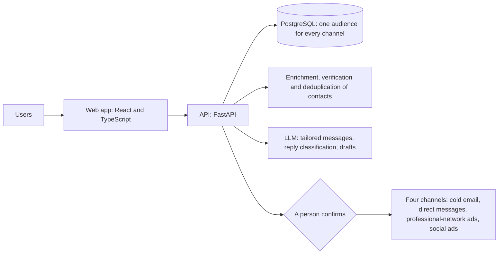

# AI-assisted multichannel campaign system: case study

> **Private code.** The source code is confidential and is not published. This repository is a case study: it describes the project at a high level, with no code, no screenshots and no internal details.

| | |
| --- | --- |
| **Client** | Confidential project |
| **Year** | 2026 |
| **Status** | In development |

## Context

Putting together a multichannel campaign took days of manual work: finding companies and contacts, verifying emails, removing duplicates, and adapting formats and messages. Each channel ended up working from a different list.

## My role

Design and development of the application: the data model, the API, the web interface and the use of the language model.

## Architecture

- An ideal customer profile becomes campaigns for four channels built on a single audience, so the same prospect is reached consistently everywhere.
- Contacts are enriched, verified and segmented before any message is written.
- A language model writes tailored messages, classifies replies and drafts responses.
- Nothing leaves without a person: every send or launch is confirmed by hand, and spending has a cap.

## Key features

- Versioned ideal customer profile and buyer personas
- Contact enrichment, verification and deduplication
- A single audience across four channels
- LLM-written messages and reply drafts
- Human confirmation before sending or launching
- Spending cap and cost logging

## Stack

Python · FastAPI · PostgreSQL · React · TypeScript · LLM API · Docker · Playwright

## Results

In development: the data, audience, email, reply and metrics-dashboard modules are built and tested in a Docker demo environment with synthetic data.
